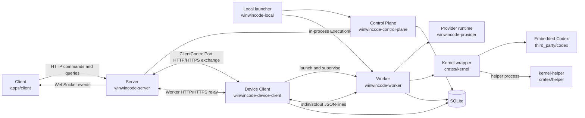
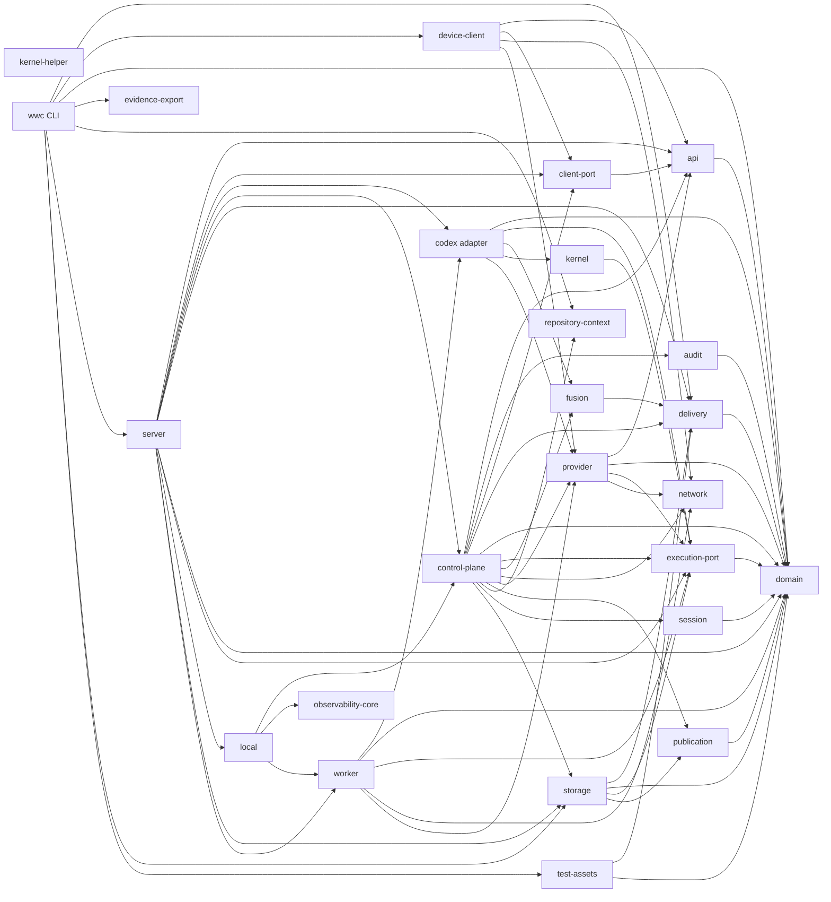

# WinWinCode 架构总览

浏览器提交任务，Server 保存产品状态并派发执行，Device Client 在设备上启动 Worker，Worker 驱动内嵌 Codex 内核。

## 组件

WinWinCode 当前由浏览器 Client、Control Plane、Execution Worker 和设备 Client 组成。`apps/client` 是产品 Client。`winwincode-server` 是独立 Server。`winwincode-worker` 是独立 Worker。`winwincode-local` 提供把 Control Plane 和 Worker 组合到一个进程中的库接口。`wwc` 来自 `crates/winwincode-cli`。

## 产品范围

WinWinCode 的已批准目标是单用户、单工作区、多项目。单个稳定 Owner 身份表示该用户。唯一工作区归属该 Owner。Owner 身份不随 Server 重启或项目切换而改变。

工作区可以包含多个项目。每个项目保留独立身份，并归属该工作区。每个仓库也保留独立身份，并归属对应项目。项目与仓库的最终基数由统一后的领域模型和契约规定。该目标不能推导成单仓库限制。

当前实现尚未完成作用域迁移。协议、领域模型和存储仍使用 organization、workspace、project、repository 四级作用域。`crates/winwincode-domain/src/generated.rs` 中的 `RepositoryScope` 仍携带四个标识。当前校验由 [作用域不变量](../invariants.md#作用域) 维护。

协议事实来源见 [契约](../contracts.md#事实来源)。原决定没有记录简化作用域的比较理由。

图中的 SQLite 节点代表多个本地数据库。它不是一个跨进程共享连接。

## Client 与 Server

`apps/client` 提供 Chat、任务、设置、审批、设备和 StrongFlow 页面。当前包已经依赖 React 18。主要装配入口是 `apps/client/src/application.ts`、`apps/client/src/boot.ts` 和 `apps/client/src/index.ts`。详细结构见 [前端架构](frontend.md)。

Client 通过 `packages/control-plane-client/src/index.ts` 和 `apps/client/src/community-control-plane-client.ts` 访问 Server。协议版本为 `winwincode/v1`。写操作进入 `/api/v1/commands`。读操作进入 `/api/v1/queries`。会话管理使用 `/api/v1/auth/session`。`/api/v1/events` 升级为 WebSocket，并推送持久事件。

`crates/winwincode-api/src/generated.rs` 定义公共 HTTP 和 WebSocket 类型。`crates/winwincode-server/src/server.rs::router` 绑定路由。`crates/winwincode-server/src/application.rs` 把传输请求交给 Control Plane 服务。

Server 对浏览器来源、会话和请求体大小做边界检查。本机 Server 默认使用回环 HTTP。远程部署使用对外 HTTPS，并由 Server 直接终止 TLS 或显式配置受保护的 loopback TLS 代理。Worker 通过父 Device 转发 ExecutionPort 请求。具体安全约束见 [安全模型](../security-model.md)。

## Control Plane 与 ExecutionPort

`crates/winwincode-control-plane` 持有产品编排和授权规则。它负责 Chat 会话、Delivery、StrongFlow 投影、Worker 注册、执行调度、Provider 准入、Publication 和审计协调。

ExecutionPort 是 Control Plane 与 Worker 之间的类型化协议。协议类型位于 `crates/winwincode-execution-port/src/generated.rs`。`crates/winwincode-control-plane/src/execution_port_service.rs::ExecutionPortService` 处理注册、心跳、租约、派发结果、运行时消息和动作授权。

同进程组合与 Device 监管的 Worker 使用同一组 `ExecutionPortMessage`：

- 同进程组合由 `crates/winwincode-local/src/lib.rs::LocalLauncher` 启动双方。`LocalExecutionPortHandle` 在进程内转发消息。
- Device 使用 `/internal/v1/client/worker-exchange` 转发子 Worker 的 ExecutionPort 和用量对账请求。`crates/winwincode-server/src/remote_worker_transport.rs::ProductionRemoteWorkerExchange` 核对 Device 归属和执行身份，并连接 `RemoteWorkerPoolAdapter`。
- Worker 使用 `crates/winwincode-worker/src/lib.rs::WorkerMain` 管理注册、租约、工作区、取消、运行时事件和终态回执。

当前生产 Server 入口通过 `run_composed_server` 调用 `run_remote_composition`，提供 Device 交换和 Worker 转发端点。实际启动配置见 [部署指南](../operations/deploy.md)。

ExecutionPort 使用持久出站消息和确认游标。传输失败不会直接抹掉已接受的产品状态。Server 会恢复已经接受但尚未完成清理的结果。

## 设备路径与 Provider

设备 Client 使用 `/internal/v1/client/exchange` 与 Server 交换 `ClientControlPort` 帧。协议位于 `crates/winwincode-client-port`。Server 端实现位于 `crates/winwincode-server/src/client_exchange.rs::ClientExchangeApplication`。设备端守护逻辑位于 `crates/winwincode-device-client/src/daemon.rs`。

设备 Client 保存设备身份、连接游标、仓库路径映射、占用状态和 Worker 进程状态。它还能接收 Worker 启动、停止、Provider 配置、扩展配置和仓库注册命令。

远程 Device 先通过 Owner 配对令牌绑定 Ed25519 公钥。它在请求前保存私钥、Server URL 和稳定绑定请求。Server 原子保存绑定回执。重启和成功响应丢失后的重试复用同一身份。Device 签名覆盖控制 HTTP、Worker HTTP 中继和 preview WSS upgrade。Worker 与 Device 使用后者创建并独占的 stdio 管道。远程配置和首次 Owner 初始化见 [部署指南](../operations/deploy.md#远程-server-与-device)。

本机启动和执行链路如下。参数来源见[部署指南](../operations/deploy.md#接入-device-client)。

1. `crates/winwincode-server/src/main.rs::load_production_startup` 读取默认配置。`run_composed_server` 打开本机 HTTP 服务。
2. `apps/client/src/runtime-config.ts` 给浏览器提供 Server 地址。HTTP 请求和 WebSocket 事件连接使用同一个 origin。
3. `crates/winwincode-cli/src/cli.rs::run_device_service_action` 启动 `crates/winwincode-device-client/src/service.rs::run_device_service`。`DeviceDaemon::tick` 完成登记，并交换设备消息。
4. 浏览器创建执行会话后，`crates/winwincode-server/src/client_sessions.rs::ClientSessionsApplication::launch` 下发 Worker 启动消息。Device 根据仓库绑定取出本机路径。
5. `crates/winwincode-device-client/src/supervisor.rs::SessionSupervisor::spawn` 写入会话配置，启动 `winwincode-worker --managed-session <配置路径>`，并接管其 stdin、stdout 和 stderr。
6. `crates/winwincode-worker/src/main.rs::run_managed` 启动 Worker。`crates/winwincode-worker/src/remote_transport.rs::DeviceRelay` 通过私有 stdio 管道交换消息。Device 的 `SessionSupervisor::start_worker_relay` 将执行和用量对账请求转发给 Server，并在本机处理凭据请求。私有管道使用 `requestId` 关联请求与响应，stderr 用于诊断日志。本地凭据类型与远程 HTTP DTO 分开。
7. Worker 收到任务后解析模型配置。`crates/winwincode-worker/src/main.rs::production_codex` 已在启动时将 helper 路径传给 Adapter 和 Kernel。实际工具调用启动该程序。

Provider 的具体执行位置在 Worker。默认部署中，Server、Web、Device 和 Worker 位于同一台机器。Device 启动并监管 Worker 子进程。`crates/winwincode-worker/src/device_model.rs::DeviceModels` 接收 `ModelOpenMessage`。`crates/winwincode-provider/src/provider_https_sse.rs::HttpsSseProviderAdapter` 负责 HTTPS/SSE Provider 调用和流转换。

设备侧 Provider 分为两个职责。`DeviceProviderStore` 由 Device 持有，保存配置、长期凭据和配置回执。`ProviderRuntimeStore` 保存模型交换、物理调用、prepared payload、恢复游标、重试和用量事实。两个 store 使用不同的 SQLite 文件。Worker 的 managed 配置使用 `providerRuntimeDirectory` 指向运行账本目录，使用 `providerExecutionProfile` 携带模型与 JEV/Fusion 路由标识。Worker 通过 `ProviderExecutionSource` 取得本次调用的内存连接材料，并直接访问 Provider。

同进程组合使用进程内 ExecutionPort。需要设备模型的组合通过 `WorkerMain::with_provider_runtime(directory, Arc<dyn ProviderExecutionSource>)` 显式注入运行账本和 Device 拥有的连接解析接口。`LocalLauncher::start` 保持通用的 `Core` 与 `Codex` 组合接口，不自动装配设备模型。同进程接口直接调用注入的 source，组件仍处于同一进程。

Server 不直接持有设备 Provider 密钥。`crates/winwincode-server/src/device_providers.rs` 把加密配置写入设备下行队列。设备 Client 应用配置，并把快照和回执上报。模型输出以 `ModelChunkMessage` 经 ExecutionPort 返回 Worker 和 Control Plane。

## Kernel 与内嵌 Codex

`third_party/codex` 是内嵌 Codex 源码。其版本由 `upstream/sources.lock.json` 锁定。当前锁定版本是 Codex 0.149.0，提交为 `758ef40f50c1a458425c7cfbf1eb12cbc07af0b0`。

`crates/kernel` 是 WinWinCode 对内嵌 Codex 的所有权边界。它通过 `codex-core-api` 创建线程和回合，并把工具调用交给 WinWinCode 的动作授权。`crates/kernel/src/model_port.rs::KernelModelStreamTransport` 把 Codex 的 `ModelStreamTransport` 接到 WinWinCode `ModelPort`。

`crates/winwincode-codex` 把 Kernel 接入 Worker。它负责线程映射、执行回执、模型桥接、候选产物、运行时投影和持久 outbox。`crates/helper` 生成 `winwincode-kernel-helper`。该程序承载 Code Mode、沙箱和文件系统辅助入口。

`ProductionCodexAdapter::with_provider_runtime` 为模型桥接附加运行账本。`with_device_extension_source` 独立注入扩展读取接口。managed Worker 通过父 Device 刷新扩展，Provider 运行账本不承担扩展配置读取。

## Chat、StrongFlow、Delivery 与 Publication

Chat 以 `ProductSession` 为产品会话。`crates/winwincode-session` 定义生命周期和执行会话绑定。`crates/winwincode-control-plane/src/product_session_service.rs` 保存消息、回合意图、取消路由和 Worker 绑定。Client 的入口位于 `apps/client/src/chat-page.ts` 和 `apps/client/src/chat-view-model.ts`。

Chat 提交后，Control Plane 创建执行作业。设备快速路径由 `crates/winwincode-control-plane/src/quick_device_execution.rs::dispatch_turn_to_device_worker` 绑定到设备 Worker。Worker 运行内嵌 Codex，并把助手输出和终态通过 ExecutionPort 返回。

Delivery 是可审计交付流程。领域模型位于 `crates/winwincode-delivery/src/domain`。Control Plane 负责命令事实、执行派发、审核结论和重做。Delivery 状态与 outbox 在同一产品事务中提交。

StrongFlow 通过 Delivery 编排交付流程。界面消费 Delivery 与运行时事实的读模型。`crates/winwincode-control-plane/src/strongflow_projection.rs::StrongFlowProjectionQueryPort` 读取 Delivery、WorkRun、候选差异、证据和运行时投影。Client 的审核页面位于 `apps/client/src/strongflow-review-detail.ts`。

Publication 是受策略约束的外部副作用。`crates/winwincode-publication` 定义 Publication、策略、操作和存储端口。`crates/winwincode-control-plane/src/publication_application.rs` 和 `publication_production.rs` 负责授权、执行和回执。Publication 只能基于已建立的 Delivery 与候选事实推进。

## SQLite 存储

Control Plane 使用 `crates/winwincode-storage/src/lib.rs::SqliteStorage`。默认数据库位于 Server 数据目录。打开数据库时启用外键、WAL 和 `synchronous=FULL`。该存储覆盖产品状态、事务回执、事件 outbox、执行队列、租约、Worker 注册、设备绑定、候选产物和 Publication。

设备 Client 使用 `crates/winwincode-device-client/src/store.rs::DeviceStore`。它使用独立 SQLite 数据库。它保存设备身份、远程绑定、上下行游标、仓库映射、占用镜像、Worker 进程记录和候选应用 journal。Server 当前 schema 为 `8`，Device 当前 schema 为 `11`。

Provider 使用 `DeviceProviderStore` 保存设备侧配置、长期凭据和配置回执，使用 `ProviderRuntimeStore` 保存执行与恢复账本。默认文件分别为 `<device-data>/providers/providers.sqlite3` 和 `<device-data>/providers/runtime/provider-runtime.sqlite3`。运行账本仍含用户请求和结果，应按敏感数据保护。`winwincode-codex` 也维护 Worker 侧执行状态。各数据库通过协议和回执协调，不共享内存事务。配置库版本 `16` 打开时会迁移原运行记录，见 [迁移与回退](../operations/deploy.md#provider-账本迁移与回退)。

审计数据由 `crates/winwincode-audit` 持久化。审计事件使用摘要链检测篡改。存储与恢复约束见 [系统不变量](../invariants.md) 和 [部署](../operations/deploy.md)。

## 网络策略

`crates/winwincode-network` 提供统一的网络失败分类、重试决策、可取消 I/O 和可选请求日志。`NetworkFailure` 记录失败种类、请求阶段、是否已被上游接受、HTTP 状态和 `Retry-After`。调用方据此决定立即重试、等待连接、重放或终止。

Provider 的 HTTPS/SSE 请求使用这一传输层。设备 Client 和 Worker 也复用失败分类。请求取消会关闭已登记的套接字，从而中止阻塞 I/O。

Device 的持久队列负责远程控制交换重试。单次 HTTP 执行器保留 `Retry-After`，Worker 中继把结构化 `NetworkFailure` 传回调用方。每条请求路径由登记的单一责任方决定退避。Device 认证的首次 401 只刷新一次挑战；永久认证失败和吊销进入停机路径。

前端请求使用 `packages/network-request`。`scripts/generate-network-policy.mjs` 从 `schema/winwincode/network-request-policy.json` 生成 `packages/network-request/src/policy.generated.mjs`。Rust 网络层与前端请求层分别实现各自的传输接口。

执行中的网络动作还受 ExecutionPort 动作策略约束。`crates/winwincode-execution-port/src/action_normalizer.rs` 把网络、Shell、文件、Git 和 MCP 请求规范化。`WorkerActionGateway` 要求有效执行租约和动作授权回执。网络失败策略不能替代权限检查。

## 第一方 crate 依赖

下图只显示工作区内当前产品 crate 的 Cargo normal 依赖。箭头表示左侧 crate 依赖右侧 crate。可选 normal 依赖也包含在图中。第三方依赖不在图中。

`kernel-helper` 只依赖内嵌 Codex crate 和 Tokio，因此图中没有第一方出边。

模块职责见 [crate 清单](crates.md)。发布边界见 [发布指南](../operations/release.md#发布边界)。
